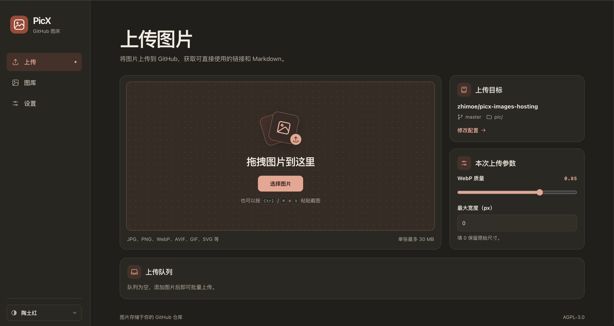

# PicX

🏞️ 一个轻量的 GitHub 图床：浏览器里拖入图片，自动转成 WebP，上传到你自己的
GitHub 仓库，拿到 jsDelivr 链接和 Markdown。页面由 Cloudflare Worker 的
Basic Auth 保护，不需要数据库，也不需要服务端保存 GitHub Token。

> 本项目参考 [PicX v2](https://github.com/XPoet/picx/tree/v2) 的行为重新实现，
> 不是 PicX 官方项目，与原作者无隶属关系。

## 截图



上传页：拖拽、选择或粘贴图片，右侧可调整 WebP 质量与最大宽度。

## 当前部署

https://picx.zhi-moe.workers.dev

## 功能

- Cloudflare Worker Basic Auth 密码保护
- 拖拽、文件选择、剪贴板粘贴上传
- 浏览器端 WebP 转换，可调质量和最大宽度
- 每张图片一次 GitHub Contents API 请求；最多 3 张并发，重名和 409 冲突自动重试
- 递归读取分支 tree，列出仓库中已有图片
- jsDelivr CDN 链接、Markdown 单条/批量复制
- 图库搜索、懒加载缩略图、刷新 jsDelivr 缓存
- 只有一个运行时依赖：`solid-js`

## 要求

- Node.js >= 22.12
- 一个 **公开** 的 GitHub 仓库（jsDelivr 无法公开访问私有仓库）
- GitHub Token（选择方式见下文）
- Cloudflare 账号 (使用免费额度的 worker 即可满足个人使用)

## 默认配置

设置页已预填以下值，可以在页面上修改：

| 字段 | 默认值 |
|---|---|
| Owner | `zhimoe` |
| 仓库 | `picx-images-hosting` |
| 分支 | `master` |
| 上传目录 | `pic` |
| WebP 质量 | `0.85` |
| 最大宽度 | `0`（保持原尺寸） |
| 随机文件名后缀 | 关闭 |

Token 不会预填，需要自己填写。所有设置只保存在当前浏览器的 localStorage。

## 本地开发

```bash
npm install
npm run dev
```

打开 http://localhost:5173, Vite 开发服务器没有密码，不要暴露到公网。

要测试真实的 Worker + Basic Auth：

```bash
cp .dev.vars.example .dev.vars
# 编辑 .dev.vars，填入 BASIC_USER / BASIC_PASS
npm run worker:dev
```

打开 http://localhost:8787, 用 `.dev.vars` 里的用户名/密码登录。

常用命令：

| 命令 | 作用 |
|---|---|
| `npm run dev` | 本地 UI（无密码） |
| `npm run build` | 构建静态资源到 `dist/` |
| `npm run preview` | 预览构建结果 |
| `npm run typecheck` | 类型检查（前端 + Worker） |
| `npm test` | 运行辅助函数测试 |
| `npm run check` | 类型检查 + 测试 + 构建 |
| `npm run worker:dev` | 构建并运行真实 Worker（读取 `.dev.vars`） |
| `npm run deploy` | 构建并部署到 Cloudflare |

## GitHub Token 怎么选

### 推荐：Fine-grained token（最小权限）

1. GitHub → Settings → Developer settings → Personal access tokens →
   Fine-grained tokens → Generate new token
2. **Repository access** 选择 *Only select repositories*，只勾选
   `zhimoe/picx-images-hosting`
3. **Permissions**：
   - `Contents`：**Read and write**（上传、读取目录）
   - `Metadata`：Read-only（选择 Contents 后会自动带上）
4. 其他权限都不需要。

如果仓库属于组织，组织需要允许使用 fine-grained token。

### Classic token

- 公开仓库：只勾 **`public_repo`** 即可。
- 私有仓库：才需要勾 **`repo`**。
- 不要勾 `workflow`、`gist`、`admin:*`、`delete_repo`、`packages` 等无关权限。

> Token 只填在设置页，**不要发到聊天、提交到仓库或写进 Worker**。
> 网页登录密码是 `BASIC_USER` / `BASIC_PASS`，和 GitHub Token 是两回事。

## 部署到 Cloudflare Workers

### 1. 登录 Cloudflare

```bash
npx wrangler login
```

### 2. 首次部署

```bash
npm run deploy
```

第一次部署会创建 Worker，并打印地址，格式为：

```
https://<Worker 名>.<账号 workers.dev 子域>.workers.dev
```

本项目的 Worker 名是 `picx`，所以地址类似
`https://picx.<你的账号子域>.workers.dev`。当前部署的账号子域是 `zhi-moe`，
地址为 `https://picx.zhi-moe.workers.dev`。

> 首次部署时还没有网页密码，访问会返回
> `500 Auth is not configured.`，这是正常的保护行为。下一步设置密码。

### 3. 设置网页登录密码

**必须在 Worker 已存在后执行**，所以先部署再设置：

```bash
npx wrangler secret put BASIC_USER    # 例如 me
npx wrangler secret put BASIC_PASS    # 输入长随机密码
```

- 请在**交互式终端**里运行，隐藏输入才能正确写入。
- 设置后立即生效，不需要重新部署。
- 两个 secret 没齐之前，Worker 不会提供任何页面。

### 4. 访问

打开 `https://picx.<你的账号子域>.workers.dev`，输入刚才的
`BASIC_USER` / `BASIC_PASS`。

### 关于 workers.dev 子域

URL 规则是 `<Worker 名>.<账号子域>.workers.dev`：

- **Worker 名**在 `wrangler.jsonc` 里，每个 Worker 一个。
- **账号子域**是 Cloudflare 账号级的，所有 Worker 共用；在
  Dashboard → Workers & Pages → **Your subdomain** → **Change** 修改。
- 修改账号子域会改变该账号下所有 Worker 的 workers.dev 地址。
- 长期使用建议绑定自定义域名：
  Workers → `picx` → Settings → Domains & Routes → Add custom domain。

### 5. 配置并使用

1. 登录后进入 **设置**，填写 GitHub Token、Owner、仓库、分支、上传目录。
2. 点 **测试连接**，确认仓库和分支可读、Token 有写权限。
3. 点 **保存配置**。
4. 到 **上传** 页拖入图片，或点击选择、直接粘贴截图。
5. 上传完成后复制 Markdown / URL；图库页可以搜索和批量复制。

上传目录支持 `{yyyy}`、`{mm}`、`{dd}` 占位符，例如 `pic/{yyyy}/{mm}`；
留空表示仓库根目录。

## 已知限制

- jsDelivr 只服务公开仓库；私有仓库 API 可读写，但生成的链接会 404。
- GIF 和 SVG 原样上传，不转 WebP，避免丢失动画或矢量。
- 单张输入上限 30 MB；转换后超过约 20 MB 的文件会被拒绝。
- 图库只列出当前配置分支的图片；其他分支的旧图片不显示，但旧链接不受影响。
- Git LFS 文件不会被 jsDelivr 直接提供。
- 仓库文件很多时 GitHub 会截断 tree，图库会显示提示并分批加载。
- GitHub Token 存在浏览器 localStorage；换设备或换域名需要重新填写。
- 新上传的文件 jsDelivr 可能短暂 404，点“刷新 CDN”或等几分钟。
- 浏览器必须能访问 `api.github.com` 和 `cdn.jsdelivr.net`；如果使用代理，
  代理要覆盖浏览器本身，而不只是终端。
- `*.workers.dev` 在部分网络下不稳定，可绑定自定义域名。
- 旧 PicX v2 的设置存在旧域名下，本应用读不到，需要重新填写；
  只要仓库、分支和路径不变，旧图片和旧链接不受影响。

## 项目结构

```
src/lib/        links、WebP 转换、GitHub API、本地设置
src/components/ 上传、图库、设置、提示、复制按钮
worker/         Basic Auth + 静态资源
tests/          纯函数测试（Node test runner）
```

## License

GNU Affero General Public License v3.0，见 `LICENSE`。
